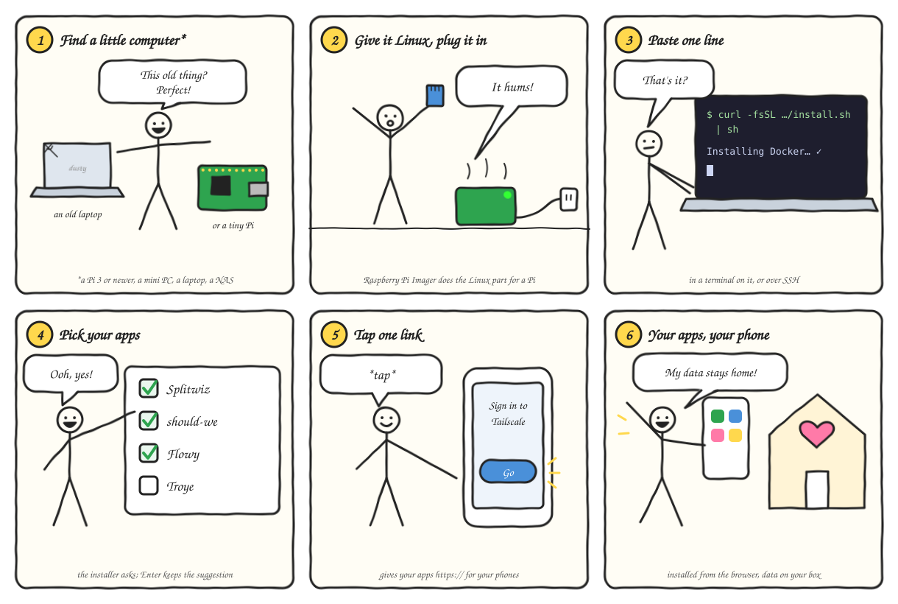

<div align="center">

# selfhostit

**Small apps you run on your own hardware.**<br>
Your data stays home, on a NAS, a Raspberry Pi or a cheap server. Each app is one small
container, installs on your phone from the browser, and needs no account on anyone's cloud.

[](https://github.com/selfhostit/plasto/generate)
[](https://buymeacoffee.com/kalfasyan)

</div>

## Apps

| | | |
|:---:|---|---|
|  | **[Splitwiz](https://github.com/selfhostit/splitwiz)** | Split shared costs with your partner or roommate. A self-hosted Splitwise for two, with CSV import. |
|  | **[should-we](https://github.com/selfhostit/should-we)** | Pick one option together. Everyone weighs what matters to them and rates each option, and you get one ranking. |
|  | **[Flowy](https://github.com/selfhostit/flowy)** | A private period and cycle tracker: predictions, a day log, insights and reminders, with Mochi the cat. |
|  | **[Troye](https://github.com/selfhostit/troye)** | A private calorie and weight tracker. Food photos are read by a vision model on your own GPU. *Work in progress.* |

## Get started



1. **Find a little computer\*.** An old laptop in a drawer, a mini PC, a Raspberry Pi 3 or
   newer, or a NAS that runs Docker. It just has to stay on.
2. **Give it Linux and plug it in.** On a Pi, [Raspberry Pi Imager](https://www.raspberrypi.com/software/)
   does this in a few clicks ([step by step](https://github.com/selfhostit/docs/blob/main/linux.md)).
3. **Paste one line** in a terminal on it, or over SSH:

   ```sh
   curl -fsSL https://raw.githubusercontent.com/selfhostit/docs/main/install.sh | sh
   ```

4. **Pick your apps.** The installer sets up Docker if it's missing and asks a few questions;
   pressing Enter keeps the suggested answer.
5. **Tap one link** to sign in to [Tailscale](https://tailscale.com) (free), so your phones
   reach the apps over `https://` from anywhere, and only yours can.
6. **Open the apps on your phone** and add them to your home screen. Your data stays home.

Is it one click? Not quite: one line to paste and one link to tap. Run the same line again
to update; your settings and data are kept. On a NAS, see the
[Synology](https://github.com/selfhostit/docs/blob/main/synology.md) and
[other NAS](https://github.com/selfhostit/docs/blob/main/other-nas.md) guides.

<sub>\* [What you need](https://github.com/selfhostit/docs#what-you-need): anything that runs
Docker on amd64, arm64 or armv7 (a Raspberry Pi 3 or newer, 64-bit Raspberry Pi OS is
best), with about 128 to 512 MB of memory per app.</sub>

## Build your own: plasto


**[plasto](https://github.com/selfhostit/plasto)** is the template the apps grow from. It takes
an idea to an app on your phone, running in one small container, without rebuilding the
same parts every time. You add your data model and screens; plasto brings the rest:

- Sign-in, users and roles, with a first-run setup screen
- A SQLite database with an admin UI and realtime updates ([PocketBase](https://pocketbase.io))
- A phone-installable web app in [Svelte 5](https://svelte.dev) and [Tailwind](https://tailwindcss.com), with dark mode
- Push notifications from your own server, with no third-party service
- Scheduled jobs that catch up after downtime, and nightly backups
- Python workers for the heavy lifting (ML, scraping, LLMs), on the same machine or another
- A one-command deploy, with images for amd64, arm64 and armv7 on
  [ghcr.io/selfhostit](https://github.com/orgs/selfhostit/packages)

```sh
# On GitHub: "Use this template", then
scripts/rename.sh      # plasto becomes your app's name
make setup             # install dependencies
make dev               # backend on :8090, web app on :5173
```

<div align="center">

**Simple. Intuitive. Self-hosted. Fast.**

</div>
