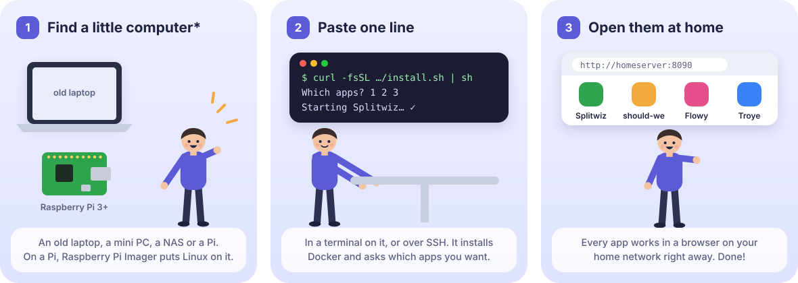
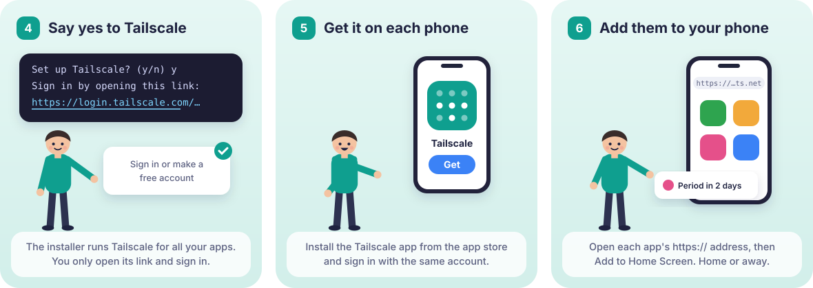

<div align="center">

# selfhostit

**Small apps you run on your own hardware.**<br>
Your data stays home, on a NAS, a Raspberry Pi or a cheap server. Each app is one small
container, installs on your phone from the browser, and needs no account on anyone's cloud.

[](https://github.com/selfhostit/plasto/generate)
[](https://buymeacoffee.com/kalfasyan)

</div>

## Apps

| | | |
|:---:|---|---|
|  | **[Splitwiz](https://github.com/selfhostit/splitwiz)** | Split shared costs with your partner or roommate. A self-hosted Splitwise for two, with CSV import. |
|  | **[should-we](https://github.com/selfhostit/should-we)** | Pick one option together. Everyone weighs what matters to them and rates each option, and you get one ranking. |
|  | **[Flowy](https://github.com/selfhostit/flowy)** | A private period and cycle tracker: predictions, a day log, insights and reminders, with Mochi the cat. |
|  | **[Troye](https://github.com/selfhostit/troye)** | A private calorie and weight tracker. Food photos are read by a vision model on your own GPU. |
|  | **[Shoppa](https://github.com/selfhostit/shoppa)** | A shared shopping list for your household, with the exact product and its photo from Open Food Facts, or a barcode scan. Works offline in the shop. |  
|  | **[Calio](https://github.com/selfhostit/calio)** | Your household on one calendar: plans, pet sitting and trips. See who is sitting the pets and whether they're booked, and subscribe from Apple, Google or Outlook Calendar. |  

## Get started

**1. Install the apps you want.** You need a little computer that runs Linux\* and a
terminal on it (or SSH). Then:

```sh
curl -fsSL https://github.com/selfhostit/docs/releases/latest/download/install.sh | sh
```



The installer sets up Docker if it's missing, asks which apps you want, and starts them.
Each app runs on its own, so pick one, a few or all, and add more later. To skip the menu,
name them at the end: `... install.sh | sh -s -- flowy`. Run the same line again to update;
your settings and data are kept.
[Step by step for a Pi or Linux](https://github.com/selfhostit/docs/blob/main/linux.md),
or for a [Synology](https://github.com/selfhostit/docs/blob/main/synology.md) or
[another NAS](https://github.com/selfhostit/docs/blob/main/other-nas.md).

**2. Make your account.** The installer lists each app's address and a one-time setup code.
Open the address, type the code and create your account.
[After you install](https://github.com/selfhostit/docs/blob/main/first-steps.md) covers adding
your household and what to do when an app doesn't open.

**3. Open them from your phones, at home and away.** The apps only answer on the machine they
run on. To reach them from your phone or laptop, and to install them on your phones (which
needs `https://`), the installer can give all your apps `https://` addresses with
[Tailscale](https://tailscale.com), a free private network that only your own devices can
reach: say yes when it asks. There is nothing to install on the server, because the
installer runs Tailscale for you; you sign in once, and each phone gets the Tailscale app.



Already have a domain? Use [a reverse proxy](https://github.com/selfhostit/docs/blob/main/phones.md#your-own-domain-with-a-reverse-proxy) instead of Tailscale.

<sub>\* [What you need](https://github.com/selfhostit/docs#what-you-need): anything that runs
Docker on amd64, arm64 or armv7, such as an old laptop, a mini PC, a NAS with a Docker app or
a Raspberry Pi 3 or newer (64-bit Raspberry Pi OS is best), with about 128 to 512 MB of memory
per app.</sub>

## Security and privacy

Your data stays on your machine, in one folder per app; there is no selfhostit cloud and no
tracking. The apps listen on `127.0.0.1` only and are reached through Tailscale or your own
reverse proxy, run in locked-down containers, and ask for a one-time setup code on a fresh
install. [Security and privacy](https://github.com/selfhostit/docs/blob/main/security.md)
says what is done, what you are trusting and what is not done yet. Prefer to read the
installer before running it? [Here's how](https://github.com/selfhostit/docs/blob/main/security.md#read-and-check-the-installer-before-you-run-it).
Found a problem? See the [security policy](https://github.com/selfhostit/.github/blob/main/SECURITY.md).

## Build your own: plasto


**[plasto](https://github.com/selfhostit/plasto)** is the template the apps grow from. It takes
an idea to an app on your phone, running in one small container, without rebuilding the
same parts every time. You add your data model and screens; plasto brings the rest:

- Sign-in, users and roles, with a first-run setup screen
- A SQLite database with an admin UI and realtime updates ([PocketBase](https://pocketbase.io))
- A phone-installable web app in [Svelte 5](https://svelte.dev) and [Tailwind](https://tailwindcss.com), with dark mode
- Push notifications from your own server, with no third-party service
- Scheduled jobs that catch up after downtime, and nightly backups
- Python workers for the heavy lifting (ML, scraping, LLMs), on the same machine or another
- A one-command deploy, with images for amd64, arm64 and armv7 on
  [ghcr.io/selfhostit](https://github.com/orgs/selfhostit/packages)

```sh
# On GitHub: "Use this template", then
scripts/rename.sh      # plasto becomes your app's name
make setup             # install dependencies
make dev               # backend on :8090, web app on :5173
```

<div align="center">

**Simple. Intuitive. Self-hosted. Fast.**

</div>
